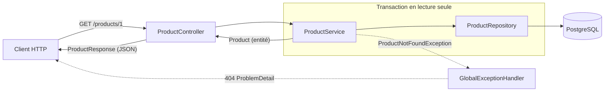

# Architecture du backend

L'API Spring Boot est le backend unique de la suite RestoForge : StockForge et
SupplyForge consomment le même contrat. Cette page décrit l'état actuel du code
et la raison de chaque convention. Elle se met à jour dans la merge request qui
change une convention.

Le schéma de la base est décrit dans le
[modèle de données](./modele-de-donnees.md), les règles fonctionnelles dans les
[règles métier](../reference/regles-metier.md).

## Le trajet d'une requête



Le controller reçoit la requête et délègue au service. Le service ouvre la
transaction, interroge le repository et rend une entité. La transaction se
ferme en sortant du service : c'est **après** sa fermeture que le controller
convertit l'entité en DTO de réponse. Une exception métier remonte jusqu'à
`GlobalExceptionHandler`, qui la traduit en réponse HTTP.

## Organisation par domaine

Le code est découpé **par domaine métier**, jamais par couche technique.

```
com.restoforge.api
├── stock/            Product, Supplier, ProductRepository, ProductService,
│   │                 ProductController, ProductNotFoundException
│   └── dto/          ProductResponse
├── commandes/        SupplierOrder, SupplierOrderLine
├── common/           GlobalExceptionHandler
└── ApiApplication.java
```

- Les packages portent le vocabulaire métier, en français (`stock`,
  `commandes`) ; les classes restent en anglais.
- L'entité ne porte aucun suffixe : elle est le concept (`Product`). Le suffixe
  désigne un rôle technique (`ProductRepository`, `ProductService`,
  `ProductResponse`).
- `common/` accueille ce qui est partagé par tous les domaines, comme le format
  des erreurs.
- Les tests suivent le même chemin de package que la classe testée.

**Pourquoi.** Ce qui change ensemble vit ensemble : une évolution du stock
touche un seul package. Le détail de la décision figure dans
l'[ADR-006](../adr/adr-006-decoupage-par-domaine.md).

## Entités JPA

Le schéma est créé par Flyway, jamais par Hibernate. Au démarrage,
`ddl-auto: validate` compare le mapping au schéma : un écart empêche
l'application de démarrer, et c'est le filet de sécurité principal.

| Convention | Pourquoi |
| --- | --- |
| `@GeneratedValue(strategy = IDENTITY)` | Les clés sont `BIGINT GENERATED ALWAYS AS IDENTITY` ; `AUTO` chercherait une séquence absente |
| `BigDecimal` pour les quantités et les prix, jamais `double` | Les colonnes sont `NUMERIC` ; un flottant binaire fausse les montants |
| Comparer avec `compareTo(...)`, jamais `equals()` | `2.0` et `2.00` ne sont pas égaux au sens de `equals` |
| `Long` et `BigDecimal`, jamais les types primitifs | Un id absent vaut `null`, pas `0` |
| `@ManyToOne(fetch = LAZY, optional = false)` | Le défaut est `EAGER`, qui charge la relation à chaque lecture |
| Un constructeur `protected` sans argument, plus un constructeur métier | Hibernate exige le premier ; le second est le seul à utiliser dans le code |
| Pas d'`equals` ni de `hashCode` | Un id encore `null` avant l'insertion les rend trompeurs |
| Annotations sur les champs, jamais sur les getters | Hibernate ignore alors les méthodes calculées comme `isBelowThreshold()` |
| Valeurs par défaut initialisées en Java (`= BigDecimal.ZERO`) | Hibernate écrit toutes les colonnes : un `DEFAULT` SQL ne s'applique pas |
| Pas de Lombok | Le code reste explicite et lisible sans plugin |

Une règle qui ne dépend que de l'objet vit **sur l'entité** :
`Product.isBelowThreshold()` porte la [règle 14](../reference/regles-metier.md).
Le stock n'a pas de setter : il n'évolue que par une méthode métier, à la
réception d'une commande.

## Repositories

- Un repository reste vide tant qu'aucun appelant n'a besoin d'autre chose que
  le CRUD hérité de `JpaRepository` : pas de méthode « pour plus tard ».
- Le type de retour d'une méthode dérivée est un contrat : `Optional` si la
  colonne est unique en base, `List` sinon. `product.name` n'est pas unique.
- Une méthode héritée ne se surcharge jamais avec un type primitif
  (`findById(long)` à côté de `findById(Long)`) : deux méthodes homonymes, deux
  comportements, aucun avertissement.
- Une méthode dérivée compare un champ à un paramètre, jamais à un autre champ.
  « Produits sous le seuil » demande une requête JPQL (`@Query`).

`ProductRepository` redéclare `findAll()` et `findById()` pour charger le
fournisseur : voir [la frontière service / web](#charger-explicitement-les-relations-lues-par-un-dto).

## Services

- Le service renvoie des **entités**. La conversion en DTO se fait dans le
  controller, car d'autres services l'appellent : le service des commandes
  lira le prix d'un produit pour le recopier sur une ligne (règle 10).
- Ses méthodes sont `public` : il est appelé depuis d'autres packages. En Java,
  l'absence de modificateur signifie package-private.
- `@Transactional(readOnly = true)` sur la classe ; chaque méthode d'écriture
  surcharge avec `@Transactional`.
- `getX` renvoie l'objet ou lève une exception métier
  (`XNotFoundException extends RuntimeException`) ; `findX` renvoie un
  `Optional`.
- Les exceptions métier ne portent aucun code HTTP ni import Spring Web : le
  même « introuvable » vaut 404 sur `GET /products/{id}` et 422 pour un id
  transmis dans le corps d'une requête. C'est la couche web qui traduit.
- Injection par constructeur, dans un champ `private final`, sans `@Autowired`.

## Controllers et DTO

- Le controller ne contient aucune logique : il appelle le service, convertit
  le résultat avec `XResponse.from(entité)` et le renvoie.
- Un DTO de réponse est un `record` Java, rangé dans le sous-package `dto/`.
  L'entité ne sort jamais du controller : le DTO protège le contrat d'API des
  évolutions du schéma.
- Les champs d'un DTO sont ceux dont un écran a besoin, pas le miroir de la
  table. Chaque champ est une promesse faite à deux applications.
- Une valeur calculée par une règle métier est exposée par l'API
  (`belowThreshold`), pas recalculée par les applications.
- Le controller ne rattrape aucune exception : la traduction est centralisée.

## Frontière service / web

### Open Session In View désactivé

`spring.jpa.open-in-view` est à `false` dans `application.yml`.

Activé (le défaut de Spring Boot), ce réglage garde la session Hibernate ouverte
jusqu'à la fin de la requête HTTP. Le controller peut alors lire une relation
`LAZY` après la fin du service : chaque lecture déclenche une requête SQL
silencieuse, et la connexion à la base reste tenue pendant toute la requête.

Désactivé, toute lecture d'une relation non chargée hors du service lève une
`LazyInitializationException`. L'erreur apparaît dès le développement, au lieu
d'une lenteur découverte plus tard — la même logique que `ddl-auto: validate`.

### Charger explicitement les relations lues par un DTO

`ProductResponse` expose le nom du fournisseur. `ProductRepository` redéclare
donc `findAll()` et `findById()` avec `@EntityGraph(attributePaths = "supplier")`,
qui charge le fournisseur dans la même requête que le produit.

**Conséquence assumée.** Tout appelant de ces deux méthodes reçoit le
fournisseur, qu'il en ait besoin ou non. Un commentaire au-dessus des
redéclarations le signale, puisque l'appel ne le montre pas. Si un appelant
fréquent n'a pas besoin du fournisseur, la réponse est une méthode au nom
explicite (`findAllWithSupplier()`), et `findAll()` retrouve son comportement
standard.

### Erreurs au format ProblemDetail

`common/GlobalExceptionHandler` (`@RestControllerAdvice`) traduit les exceptions
métier en réponses au format `ProblemDetail` (RFC 9457). Spring le fournit
nativement et pose le type de contenu `application/problem+json`.

```json
{
  "type": "about:blank",
  "title": "Not Found",
  "status": 404,
  "detail": "Product not found with id: 999",
  "instance": "/products/999"
}
```

Une nouvelle exception métier s'accompagne d'une méthode `@ExceptionHandler`
dans cette classe, qui choisit son code HTTP. Toutes les erreurs de l'API ont
ainsi le même format, lu de la même façon par toutes les applications.

### Options écartées

| Option | Raison de l'écart |
| --- | --- |
| Laisser Open Session In View activé | Requêtes en trop invisibles (N+1), connexion tenue pendant toute la requête HTTP |
| Convertir en DTO dans le service | Le service servirait le contrat HTTP au lieu des autres services |
| `ResponseStatusException` dans chaque controller | Logique « introuvable » dupliquée et format d'erreur propre à chaque controller |
| Méthodes explicites (`findAllWithSupplier()`) dès maintenant | Plus lisibles à l'appel, mais un seul appelant existe ; à reconsidérer quand un appelant n'aura pas besoin du fournisseur |

## Modèles de test

Chaque couche a un modèle de test, à reprendre pour les classes suivantes.

| Couche | Exemple | Mise en place | Ce qu'il prouve |
| --- | --- | --- | --- |
| Repository | `ProductRepositoryTest` | `@DataJpaTest`, base conservée (`Replace.NONE`), PostgreSQL éphémère par Testcontainers | Le mapping et les requêtes, sur un vrai PostgreSQL |
| Service | `ProductServiceTest` | Mockito seul (`@ExtendWith(MockitoExtension.class)`), sans Spring ni Docker | La logique du service, pas la simple délégation |
| Controller | `ProductControllerTest` | `@WebMvcTest(ProductController.class)`, service remplacé par `@MockitoBean`, `MockMvc` | Le code HTTP, le JSON et le format des erreurs |

**Repository.** Aucun profil n'est actif en test : la base est vide et chaque
test crée ses données, avec `TestEntityManager` pour les entités annexes.
Toujours appeler `flush()` puis `clear()` avant de relire : sinon Hibernate
rend l'objet de son cache sans interroger la base, et le test ne prouve rien.
Les montants se comparent avec `isEqualByComparingTo("8.40")`.

**Service.** On ne teste pas une méthode qui ne fait que déléguer.
`isSameAs` vérifie que le service rend l'objet du repository ;
`assertThatThrownBy(...)` vérifie l'exception et son message.

**Controller.** `@WebMvcTest` ne charge que la couche web : les controllers et
`GlobalExceptionHandler`. Avec Spring Boot 4, chaque tranche de test a son
starter : `@WebMvcTest` est fourni par `spring-boot-starter-webmvc-test`
(package `org.springframework.boot.webmvc.test.autoconfigure`), comme
`@DataJpaTest` par `spring-boot-starter-data-jpa-test`. `@MockitoBean`
remplace `@MockBean`, retiré.
