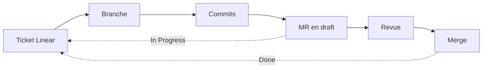

# Du ticket au merge

Le suivi se fait dans Linear (équipe RES), le code dans GitLab. Les deux sont
reliés : les statuts des tickets avancent automatiquement au rythme des merge
requests.



## 1. Le ticket

Deux modèles de ticket existent dans l'équipe RES :

| Modèle | Usage | Contenu |
| --- | --- | --- |
| **Feature** | Issue parent | Objectif métier, règles métier, critères d'acceptation, hors périmètre |
| **Ticket** | Sous-issue | Où on en est, livrable vérifiable, décisions, étapes « Quoi / Pourquoi / Vérifier », Definition of Done |

Un ticket décrit **un comportement vérifiable** et tient en une session de
travail. On découpe par comportement visible (« `POST /suppliers` renvoie
201 »), pas par couche technique. Un ticket est rédigé, ou réécrit, à ce format
avant que le développement commence.

## 2. La branche

Linear génère le nom de branche de chaque ticket (bouton « Copy git branch
name ») : `garyjohnson1994/res-XX-titre-du-ticket`.

```bash
git switch main && git pull
git switch -c garyjohnson1994/res-XX-titre-du-ticket
```

## 3. Les commits

Format : `[RES-XX] type(scope): description`.

| Élément | Valeurs |
| --- | --- |
| `type` | `feat`, `fix`, `test`, `refactor`, `docs`, `chore` — d'après l'apport principal : une MR qui livre du code, sa doc et ses tests reste `feat` |
| `scope` | Le domaine (`stock`, `commandes`, `common`) ou la brique (`web`, `mobile`, `forge-ui`, `docs`, `infra`) |

Un commit par étape du ticket. Chaque fichier s'ajoute individuellement, puis on
contrôle ce qui part :

```bash
git add chemin/du/fichier
git diff --staged --stat   # uniquement les fichiers attendus
git commit -m "[RES-XX] feat(stock): description"
```

:::caution[Aucun fichier hors périmètre]

Deux cas déjà rencontrés : des classes vides créées par l'IDE « pour plus
tard », et un `package-lock.json` réécrit par `npm install`. Ni l'un ni l'autre
n'entre dans un commit. Dans `docs/`, on installe avec `npm ci`.

:::

## 4. La merge request

- **Ouverte en draft dès le premier push.** L'ouverture fait passer le ticket
  en *In Progress*. Tant qu'elle est en draft, GitLab refuse le merge.
- **Titre renommé** au format `[RES-XX] type(scope): description`. GitLab le
  génère depuis le nom de la branche, ce qui ne respecte pas la convention. Le
  titre devient la première ligne du commit final.
- **Description courte et factuelle** : ce que la MR apporte. Le modèle de
  squash de GitLab (`%{title}`, une ligne vide, `%{description}`) en fait le
  corps du commit final. La Definition of Done reste dans Linear.
- **Revue** sur la branche, lue depuis le miroir GitHub, avant le merge.

## 5. Le merge

Le merge a lieu **quand la Definition of Done est atteinte**, pas avant : une
MR mergée clôt son ticket automatiquement.

1. **Mark as ready** (la MR quitte le draft).
2. Cocher **Squash commits** (décoché par défaut).
3. Cocher **Delete source branch**.
4. **Merge** : le ticket passe en *Done*.

Les statuts ne se déplacent jamais à la main. Seule exception : une issue
parent, qu'aucune MR ne porte, se ferme à la main une fois toutes ses
sous-issues terminées.

## Labels Linear

| Famille | Labels |
| --- | --- |
| Domaine | `back`, `front-web`, `mobile`, `design`, `forge-ui`, `infra`, `docs` |
| Module | `module:stock`, `module:commandes` |
| Type | `Feature`, `Bug`, `tech-debt`, `spike` |
| Périmètre | `hors-mvp` : une idée capturée, qui ne se code pas pendant le MVP |

## Dépôts

GitLab est le dépôt principal (merge requests, CI). Un miroir GitHub,
`GaryJnS94/restoforge`, en reproduit les branches en lecture.
